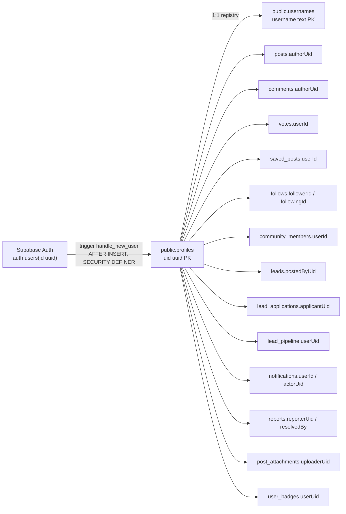
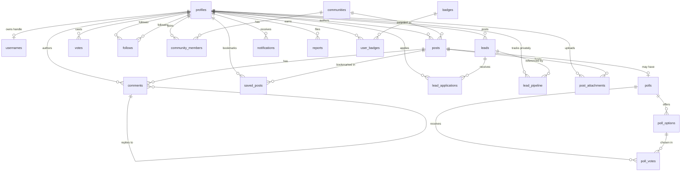
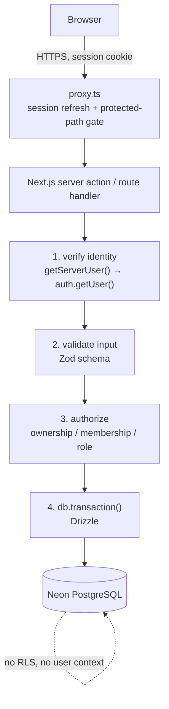

# Phase 2A — Database Audit & Architecture Design

Branch `arena/5aa6a3c8-freelancer-s-hub`, based on `540812b`.
**Audit and design only.** No Drizzle, no Neon driver, no connection, no tables, no migrations, no
query rewrites, no Supabase schema changes, no data deleted. `main` untouched.

**Evidence base.** Everything below is derived from the repository: 13 SQL files in the repo root
(3,167 lines), 36 `src/lib/*.ts` modules, and the views/components that call them. **No live Supabase
project or credentials were available**, so the repo SQL is treated as the schema of record, and every
place where the live database could differ is flagged in §15 rather than assumed away.

---

## 1. Existing database inventory

### 1.1 Tables (20)

Verified by `grep 'create table if not exists public\.' *.sql` → 20 distinct names. `storage.objects` is
Supabase-managed and is listed for completeness only, not counted.

Authoritative DDL lives in the root SQL files, applied in this order (each is written to be re-runnable):

`supabase_schema.sql` → `supabase_post_settings_and_storage_migration.sql` → `supabase_post_settings_and_polls_migration.sql` → `supabase_lead_applications_migration.sql` → `supabase_notifications_migration.sql` → `supabase_reports_and_moderation_migration.sql` → `supabase_post_interaction_hardening_migration.sql` → `supabase_ux_marketplace_pipeline_documents_migration.sql` → `supabase_achievements_badges_migration.sql` → `supabase_profile_defaults_migration.sql` → `supabase_auth_completion_migration.sql` → `supabase_architecture_hardening.sql` → `supabase_cleanup_and_roles.sql`.

| # | Table | PK | Notes |
| --- | --- | --- | --- |
| 1 | `profiles` | `uid uuid` → `auth.users(id)` **on delete cascade** | The identity anchor. Denormalised counters (`reputation`, `followers`, `following`), `skills text[]`, `role` check, `communitiesList jsonb` |
| 2 | `usernames` | `username text` | Unique-handle registry; `uid` → `profiles` cascade. Duplicates `profiles.username` (also `unique not null`) |
| 3 | `communities` | `slug text` | `ownerId text` **not** uuid (default `'system'`), `memberCount` denormalised, `topics text[]` |
| 4 | `posts` | `id uuid` | `authorUid` → profiles **cascade**, `communitySlug` → communities cascade, counters `score/ups/downs/views/commentCount`, `isDeleted`, `visibility` check, `allowComments`, `isPinned` |
| 5 | `comments` | `id uuid` | Self-referencing `parentId` **cascade**, `authorUid` cascade, counters, `isDeleted` |
| 6 | `votes` | `id uuid` | `entityType` ∈ (post, comment) + `entityId` — **polymorphic, no FK**, `voteValue` ∈ (1, −1), `unique(userId, entityType, entityId)` |
| 7 | `saved_posts` | composite `(userId, postId)` | Bookmark join table |
| 8 | `follows` | composite `(followerId, followingId)` | Self-referential M2M on profiles |
| 9 | `community_members` | composite `(userId, communitySlug)` | Join table |
| 10 | `polls` | `id uuid` | `postId` → posts cascade. **No unique constraint on `postId`** despite the "one-to-one" comment (§15) |
| 11 | `poll_options` | `id uuid` | `pollId` cascade, `position` |
| 12 | `poll_votes` | `id uuid` | `unique(pollId, userId)`, option + poll + user FKs |
| 13 | `leads` | `id uuid` | `postedByUid` cascade, `skills text[]`, `applicantsCount` denormalised, `status text` (no check) |
| 14 | `lead_applications` | `id uuid` | `unique(leadId, applicantUid)`, `status` check, `updatedAt` |
| 15 | `lead_pipeline` | `id uuid` | **Private per-user CRM**: `userUid` cascade, `leadId` → leads **on delete set null**, `unique(userUid, leadId)` |
| 16 | `post_attachments` | `id uuid` | `storagePath text unique`, check constraint tying path to `uploaderUid/postId`, `mimeType` whitelist, ≤3 per post via trigger |
| 17 | `notifications` | `id uuid` | `userId` cascade, `actorUid` **on delete set null**, `type` check (8 values), `entityId`/`contextId` uuid **with no FK** |
| 18 | `reports` | `id uuid` | Polymorphic `entityType` + `entityId` (no FK), `reason`/`status` checks, `resolvedBy` set null |
| 19 | `badges` | `id text` | Catalog; `category`/`rarity` checks, `target` |
| 20 | `user_badges` | `id uuid` | `unique(userUid, badgeId)` — the duplicate-achievement guard |

Deleted/historical: `supabase_cleanup_and_roles.sql` truncates posts/comments/votes/saved_posts and
contains destructive profile cleanup sections. It is an **operator script, not part of the schema**.

### 1.2 Enums

**There are no PostgreSQL `ENUM` types.** Every enumeration is a `text` column with a `CHECK`:

| Column | Allowed values |
| --- | --- |
| `profiles.role` | `admin`, `moderator`, `member` |
| `posts.visibility` | `public`, `members`, `admins` |
| `posts.type` | *no check* — free text, `'discussion'` default (app uses discussion/question/resource/poll) |
| `leads.status` | *no check* — free text, `'open'` default (app writes `'closed'`) |
| `lead_applications.status` | `pending`, `accepted`, `rejected`, `withdrawn` |
| `lead_pipeline.stage` | `new`, `conversation`, `proposal`, `negotiation`, `won` |
| `votes.entityType` | `post`, `comment` |
| `votes.voteValue` | `1`, `-1` |
| `notifications.type` | 8 values (comment, reply, upvote, follow, 4 × application_*) |
| `reports.entityType` | `post`, `comment`, `lead`, `profile` |
| `reports.reason` | `spam`, `harassment`, `scam`, `inappropriate`, `other` |
| `reports.status` | `open`, `resolved`, `dismissed` |
| `badges.category` | `publishing`, `helping`, `community`, `trust`, `longevity` |
| `badges.rarity` | `common`, `uncommon`, `rare`, `legendary` |

Consequence for Drizzle: these become **native pg enums** or `text` + `check`. Recommendation in §10.3.

### 1.3 Indexes

`idx_posts_createdAt`, `idx_posts_authorUid`, `idx_posts_communitySlug`, `idx_comments_postId`,
`idx_comments_authorUid`, `idx_leads_postedAt`, `idx_lead_applications_leadId`,
`idx_lead_applications_applicantUid`, `idx_votes_entity(entityType, entityId, userId)`,
`idx_notifications_user_created(userId, createdAt desc)`,
`idx_notifications_user_unread(userId) where isRead = false` (partial),
`idx_reports_status_created`, `idx_reports_reporter`,
`idx_lead_pipeline_user_updated(userUid, updatedAt desc)`,
`idx_post_attachments_post_id`, `idx_user_badges_user(userUid, earnedAt desc)`, `idx_user_badges_badge`.

Plus the implicit unique indexes from §1.1 (including `votes`, `saved_posts`, `follows`,
`community_members`, `user_badges`, `lead_applications`, `poll_votes`).

**Notably missing:** no index on `follows.followerId` alone (the PK leads with it, so fine), and no index
on `votes.entityId` for counting a post's votes (the `idx_votes_entity` leads with `entityType`, which is
sufficient).

---

## 2. Query & RPC inventory

### 2.1 Tables referenced from application code (19)

`profiles` (24 sites), `comments` (19), `posts` (17), `usernames` (8), `lead_applications` (7),
`reports` (5), `leads` (5), `follows` (5), `community_members` (5), `saved_posts` (4),
`post_attachments` (4), `notifications` (4), `lead_pipeline` (4), `communities` (4), `user_badges` (2),
`polls` (2), `poll_options` (2), `poll_votes` (2), `votes` (1), `badges` (1).

### 2.2 RPC inventory (11 distinct)

| RPC | Kind | Called from | Behaviour that must survive |
| --- | --- | --- | --- |
| `cast_vote(entity_id, entity_type, voter_uid, new_vote)` | write, **transactional** | `src/lib/votes.ts` | See §8.1 — the most important function in the system |
| `increment_post_views(post_id)` | write | `src/lib/posts.ts` | Counter bump only |
| `increment_followers` / `decrement_followers` | write | `src/lib/users.ts` | Counter bump, `greatest(0, …)` floor |
| `increment_following` / `decrement_following` | write | `src/lib/users.ts` | Counter bump |
| `increment_community_members` / `decrement_community_members` | write | `src/lib/communities.ts` | Counter bump |
| `moderate_report(report_id, new_status, remove_content)` | write, **multi-table** | `src/lib/reports.ts` | Permission check + content action + report update, atomically |
| `set_user_verified_pro(target_uid, verified)` | write, admin | `src/lib/reports.ts` | Admin-only |
| `set_user_role(target_uid, new_role)` | write, admin | `src/lib/reports.ts` | Admin-only, **self-demotion guard** |
| `can_view_post(p_id)` | **read predicate** | inside RLS | Visibility rule; must be ported verbatim (§5.2) |
| `is_moderator(uid)` / `is_admin(uid)` | **read predicate** | inside RLS/RPCs | Role lookups |
| `jsonb_set_community(uid, slug, value)` | write | **mock only** | Defined in SQL, never called by app code — dead path |

### 2.3 Triggers (13)

| Trigger | On | Effect |
| --- | --- | --- |
| `on_auth_user_created` | `auth.users` insert | Creates `profiles` + `usernames` row, honours requested username, generates fallback |
| `trg_notify_on_comment` | comments | Notification to post author / parent author |
| `trg_notify_on_vote` | votes | Notification on upvote only |
| `trg_notify_on_follow` | follows | Notification to followed user |
| `trg_notify_on_application` | lead_applications | 4 notification types by status transition |
| `trg_guard_notification_update` | notifications | Only `isRead` may change |
| `trg_guard_report_update` | reports | Only status fields may change; stamps `updatedAt` |
| `trg_guard_lead_application_update` | lead_applications | Restricts who may change which fields |
| `trg_lead_applicants_count` | lead_applications | Maintains `leads.applicantsCount` |
| `maintain_post_comment_count` | comments | Maintains `posts.commentCount`, refuses comments on frozen posts |
| `trg_post_document_limit` | post_attachments | ≤3 documents per post |
| `trg_guard_…` *(poll/community guards)* | — | See per-migration notes |

**This is the single biggest architectural fact in the audit:** an unusually large share of business
logic lives in the database — 13 triggers and 11 RPC functions, several of them `SECURITY DEFINER`.
Moving to Neon moves this logic into the application. That is the real migration cost, not the tables.

### 2.4 Realtime

**None.** `NotificationBell` polls every 30s and documents "v1 has no realtime subscription". The only
`subscribe()` calls are Supabase Auth state listeners. No `postgres_changes` anywhere.

---

## 3. Implemented vs partial vs mock vs UI-only

### 3.1 Implemented and working (backed by tables + RLS + triggers)

Profiles & identity · usernames · posts (incl. visibility, soft delete, pinning) · comments + replies ·
votes (atomic RPC) · bookmarks · follows · communities + memberships · leads · lead applications ·
personal pipeline · notifications (trigger-generated) · reports & moderation · Verified Pro & roles ·
badges catalog + earned badges · post documents (private bucket, signed URLs) · image uploads.

### 3.2 Implemented but partially so

| Area | Gap |
| --- | --- |
| **Badges** | `src/lib/badges.ts` **falls back to client-side computation** when the migration isn't applied. Two sources of truth for "which badges are earned" |
| **Poll votes** | `unique(pollId,userId)` prevents re-voting but there is **no vote-changing and no counter** on options — counts are computed by counting rows |
| **Community roles** | Only `communities.ownerId` (text) + a global `profiles.role`. **No per-community moderator/member role table** despite the brief's "Roles / Community moderation" |
| **Reputation** | Written by `cast_vote` only; `calculateReputation()` recomputes from posts client-side, so the two can disagree |
| **`posts.type` / `leads.status`** | Free text with no check constraint or enum |
| **`polls.postId`** | Comment says one-to-one; no unique constraint enforces it |
| **`communitiesList jsonb`** | Duplicates `community_members`; written by a dead RPC, read by nothing |

### 3.3 Mock / demo only

`src/lib/mockSupabase.ts` (1,700+ lines) is an entire localStorage-backed fake backend used when
`NEXT_PUBLIC_DEMO_MODE=true`. It implements **17 of the 20 tables** (`badges`, `user_badges`,
`usernames` and storage metadata partially). It is a dev convenience, **not** a competing production data
model — but it must be kept in sync or demo mode silently diverges.

### 3.4 UI-only (no persistence)

Drafts (`localStorage`, per-uid), UI preferences (`uxPersistence`: sidebar/theme/filters), onboarding
form state (writes to `profiles` on save), `communitiesList` topic preferences.

### 3.5 Planned / specified but **not built**

| Feature in the brief | Reality |
| --- | --- |
| **Messaging: conversations, messages, read receipts** | **Does not exist.** No table, no `src/lib` module, no view. The word "message" in the codebase is notification copy and error text |
| **Mentions** | Not implemented (no parse, no table, no notifications) |
| **Post media (gallery)** | Images are markdown-embedded URLs in `posts.body`, not a media table |
| **Verification requests** | No request table/workflow; `profiles.isVerifiedPro` is set directly by an admin RPC |
| **Application history / activity feed** | No events table; achievements are computed from counts |
| **Per-community roles** | Not modelled |

**Per the brief's instruction, none of these get a table in the target design.** §5 designs only what
exists; §15 lists them as decisions for a later phase.

---

## 4. Identity & profile relationship analysis

### 4.1 Current chain



**Every ownership column is `profiles.uid`, and `profiles.uid` *is* the Supabase Auth UUID.** There is no
separate application user id anywhere. That is the single most important fact for the migration.

### 4.2 Counts referencing identity

- **20 FK columns** reference `profiles.uid` (all cascade, except `notifications.actorUid` and
  `reports.resolvedBy`, which are `set null`).
- **1 column stores identity as text**: `communities.ownerId text`. Every RLS policy that touches it
  compares `auth.uid()::text = "ownerId"` — a cast, not a constraint. It has no FK and can hold
  `'system'` (the seeded communities), so it can never be a plain uuid FK without special-casing.
- **3 polymorphic columns** hold identity *implicitly* via entity ids with no FK:
  `votes(entityType, entityId)`, `notifications(entityId, contextId)`, `reports(entityType, entityId)`.

### 4.3 Client-side identity duplication

`ensureUserProfile()` is called by `AuthProvider` on **every** session change and by Login/Signup. It is a
**client-side reimplementation of the `handle_new_user` trigger**: it looks up the profile, and if absent
computes a username and inserts one. Two independent profile-creation paths exist.

### 4.4 How the Supabase Auth UUID should be represented in Neon

**Recommendation: keep the exact Supabase Auth UUID as the profile primary key.**

```
Neon: profiles.uid uuid PRIMARY KEY     -- same value as auth.users.id
      -- no FK to auth.users (different database); no new identity system
```

Rationale, grounded in what exists:

1. **Zero data translation.** All 20 FK columns keep their values; no id mapping table, no rewrite.
2. **No new identity system**, as the brief requires. Supabase Auth stays authoritative; Neon stores a
   *reference* to it, not a copy of an identity.
3. **JWT claims carry the same value**, so a server-side `getServerSession().uid` (§5.1) indexes Neon
   directly.
4. **The FK cannot be enforced across databases.** The replacement is a documented invariant plus a
   server-side guarantee: a row is only ever inserted with a `uid` taken from a *verified* JWT. This is
   weaker than the current `references auth.users(id) on delete cascade` — see §15 risk R3 for the
   deletion-semantics gap, which needs a decision.

**Do not** introduce surrogate `profiles.id` + `auth_uid` mapping in this migration: it adds a join to
every ownership check and creates a second identity to keep consistent, for no current benefit.

---

## 5. Domain model

Legend: **[I]** implemented · **[P]** partial · **[M]** mock/demo-backed only · **[U]** UI-only.



### 5.1 Identity & profiles — **[I]**
`profiles` (1 per auth user), `usernames` registry, `role`, `isVerifiedPro`, `hasSeenVeteranCelebration`
(profile-completion proxy), denormalised `reputation/followers/following`.

### 5.2 Social publishing — **[I]** / **[P]**
`posts` (visibility, soft delete, pinning, externalLink), `comments` (unbounded nesting via `parentId`,
same-post constraint enforced by trigger), `votes` (polymorphic), `saved_posts`.
**Tags are `posts.tags text[]`, not a table.** Mentions, mentions-notifications and post media tables do
not exist.

### 5.3 Communities — **[I]** / **[P]**
`communities` (slug PK, text owner), `community_members` (join, no role column). Community posts are
`posts.communitySlug`. **Moderation is global-role-based only** (`profiles.role` + `is_moderator`), not
per-community.

### 5.4 Freelance ecosystem — **[I]**
`leads` (public board), `lead_applications` (unique per applicant/lead, guarded transitions),
`lead_pipeline` (**private** per-user prospect tracker, distinct from public leads — deliberately, per the
migration's comments). Client/freelancer relationship is implicit in application status, with no
`clients` table.

### 5.5 Reputation — **[I]** / **[P]**
`badges` catalog (seeded), `user_badges` (unique guard), `profiles.reputation` + XP-like counters.
**No `xp` column and no activity/events table** — achievements are computed from counts at render time
(`src/lib/badges.ts`), with a DB fallback. Leaderboard reads `profiles.reputation`.

### 5.6 Communication — **not built**
Only `notifications` (one-way, trigger-generated, read-flag only). Conversations/messages/read receipts
do not exist (§3.5).

### 5.7 Administration — **[I]**
`reports` (polymorphic target, guarded update), `moderate_report` RPC (permission + content action +
status, atomic), `set_user_role` / `set_user_verified_pro` (admin-only, self-demotion guard).

---

## 6. Relationships, constraints, integrity

### 6.1 Cardinalities

| Relationship | Type | Enforcement |
| --- | --- | --- |
| auth user → profile | 1:1 | PK = `auth.users.id` + cascade |
| profile → username | 1:1 | `usernames.username` PK + `profiles.username` unique |
| post → poll | 1:1 *(intended)* | **Not enforced** — `polls.postId` lacks a unique index |
| post → comments | 1:N | FK cascade |
| comment → comment | 1:N self | FK cascade + same-post trigger check |
| profile ↔ profile (follows) | M:N self | composite PK |
| profile ↔ post (saved_posts) | M:N | composite PK |
| profile ↔ community | M:N | composite PK, **no role column** |
| lead → applications | 1:N | FK cascade + `unique(leadId, applicantUid)` |
| profile → badge | M:N | `unique(userUid, badgeId)` |
| vote → entity | polymorphic | `unique(userId, entityType, entityId)`, **no FK** |

### 6.2 Duplicate-prevention (the brief's checklist)

| Requirement | Current enforcement | Preserved in Neon by |
| --- | --- | --- |
| No duplicate votes | `unique(userId, entityType, entityId)` **+ advisory lock in `cast_vote`** | Unique partial index per entity table (§8.1) |
| No duplicate bookmarks | composite PK `(userId, postId)` | Same PK |
| No duplicate memberships | composite PK `(userId, communitySlug)` | Same PK |
| No duplicate achievements | `unique(userUid, badgeId)` | Same unique |
| No duplicate applications | `unique(leadId, applicantUid)` | Same unique |
| No duplicate poll vote | `unique(pollId, userId)` | Same unique |
| Post/comment integrity | FK + `maintain_post_comment_count` trigger + same-post parent check | FK + service-layer check in same transaction |

### 6.3 Cascades vs restricts

All `profiles.uid` references are **cascade** — deleting an auth user destroys their content. Two are
**set null**: `notifications.actorUid`, `reports.resolvedBy`. `lead_pipeline.leadId` is **set null** so
deleting a public lead does not destroy a user's private CRM entry. In Neon, cross-database cascade is
impossible, so **account deletion becomes an explicit server-side transaction** (§15 R3).

### 6.4 Transactional requirements

| Operation | Today | Risk if done naively |
| --- | --- | --- |
| `cast_vote` | One `SECURITY DEFINER` transaction: row locks, advisory lock, vote upsert, counter delta, reputation delta | **High** — see §8.1 |
| `follow` / `unfollow` | **Client: 5 sequential calls** (lookup → insert/delete → 2 RPCs) | **Already broken** — §8.2 |
| `join`/`leave community` | **Client: 2–3 sequential calls** | **Already broken** — §8.2 |
| `moderate_report` | One transaction (permission, content action, status) | Medium |
| Comment insert | Trigger maintains `commentCount` + refuses frozen posts | Medium |
| Application status change | Trigger guard + `applicantsCount` trigger + notification trigger | Medium |
| Attachment upload | Insert metadata, then storage; limit trigger | Medium |

---

## 7. (merged into §6 and §8)

---

## 8. Concurrency, atomicity and the two known-unsafe flows

### 8.1 `cast_vote` — must be ported as a single transaction

The function does all of the following inside one transaction:

1. Rejects `auth.uid()` ≠ `voter_uid` (nobody votes as another user).
2. Validates `new_vote ∈ (−1, 0, 1)`.
3. `SELECT … FOR UPDATE` on the target post/comment (and the parent post for a comment) — so a concurrent
   delete/visibility change serialises against voting.
4. Rejects votes on deleted content and on posts the voter cannot see (`can_view_post`, needed because
   `SECURITY DEFINER` bypasses RLS).
5. Rejects self-votes.
6. `pg_advisory_xact_lock(hash(voter||entity||id))` — **the anti-double-count guard**.
7. Re-reads the previous vote `FOR UPDATE`; no-ops if unchanged.
8. Upserts or deletes the vote row (`ON CONFLICT DO UPDATE`).
9. Applies `score/ups/downs` deltas computed from `previous → new`.
10. Applies the same `score` delta to `profiles.reputation` of the content author.

**Why it cannot become client code:** steps 6–9 must share one transaction *and* one lock. Two rapid
clicks or two tabs that both read "no previous vote" would otherwise each apply a +1, permanently
inflating `score`, `ups` and `reputation`. The existing code already proves this failure mode existed —
the hardening migration exists precisely to fix it.

**Neon/Drizzle requirement:** implement `cast_vote` as either (a) a preserved PostgreSQL function
(`CREATE FUNCTION` in a Drizzle-authored SQL migration, called via `db.execute`), or (b) an interactive
`db.transaction()` using `SELECT … FOR UPDATE` + `pg_advisory_xact_lock` with identical semantics.
**Recommendation: (a)** — port the SQL function essentially unchanged. It is already correct, already
tested in production, and re-expressing it in TypeScript adds risk without benefit. Either way,
`score`/`ups`/`downs` remain denormalised columns, not `count(*)` at read time.

### 8.2 Two flows that are already non-atomic (fix during migration, do not carry over)

**`toggleFollow`** (`src/lib/users.ts`) — lookup, then insert/delete, then **two counter RPCs**, across
five round trips with no transaction. A failure after the `follows` insert leaves `followers`/`following`
short; a failure after one RPC leaves the two counters disagreeing.

**`joinCommunity` / `leaveCommunity`** (`src/lib/communities.ts`) — member row then counter RPC, two
round trips. On insert-conflict the error is thrown before the counter RPC, so the common double-join is
safe, but any counter failure still drifts `communities.memberCount`. `leaveCommunity` **swallows** the
decrement error entirely.

`toggleBookmark` is a lookup-then-write race, but the composite PK makes the worst case a failed insert
rather than corruption — acceptable, and worth tightening opportunistically.

**Recommendation:** in Neon these become single service-layer transactions, and — where drift is already
possible — the counters get a reconciliation query. Do not ship a TypeScript port that reproduces the
multi-call sequences.

---

## 9. Security & authorization architecture

### 9.1 The core fact

**Neon inherits nothing from Supabase.** RLS, `auth.uid()`, `auth.role()` and every `SECURITY DEFINER`
grant disappear. Today the database is the last line of defence: a client-side bug cannot leak another
user's `lead_pipeline` rows because RLS refuses. After the move, **authorization is only as good as the
server code**.

### 9.2 Target architecture



Rules this implies:

1. **Identity is never taken from the request body.** `uid` comes from the verified JWT only —
   today's `cast_vote(voter_uid, …)` explicitly re-checks `auth.uid() = voter_uid`; in Neon that check
   becomes unnecessary *because the parameter disappears*.
2. **Neon is reached only through `src/server/db/**`,** which is server-only (§10.4). Connection strings
   are never bundled.
3. **Authorization is an explicit, testable function per resource**, not a policy string scattered in SQL:
   `assertCanViewPost(uid, postId)`, `assertOwner(uid, row)`, `assertCommunityMember(uid, slug)`,
   `assertModerator(uid)`, `assertAdmin(uid)`.
4. **RLS-style read filtering is now a query concern.** Every read of a visibility-scoped table must
   apply `can_view_post` semantics in SQL (§5 of the old policies). This is where a migration silently
   regresses privacy — see §15 R1.

### 9.3 Porting `can_view_post` (the visibility rule)

Current semantics, and they must be preserved exactly:

| Post | Viewer | Visible? |
| --- | --- | --- |
| `public` | anyone | yes |
| any | anonymous | **no**, except `public` |
| any | `authorUid` | yes |
| any | `admin`/`moderator` | yes |
| `members` | member of `communitySlug` | yes |
| `admins` | owner of `communitySlug` | yes |
| `members`/`admins` | anyone else | no |

It is applied to `posts`, `comments`, `polls`, `poll_options`, `poll_votes`, `post_attachments`. In Neon
this becomes one shared SQL predicate (a `VIEW` or a reusable `where` fragment) used by every query that
touches those tables. **Recommendation: define it once in Drizzle as a reusable `SQL` expression and
require every reader to use it** — plus a test matrix (§9.5).

### 9.4 Authorization responsibilities that move to the application layer

| Concern | Today | After |
| --- | --- | --- |
| Row visibility | RLS + `can_view_post` | Query predicate + tests |
| Ownership on update/delete | RLS `using (auth.uid() = …)` | `assertOwner` in the mutation |
| Moderator/admin actions | `is_moderator` / `is_admin` in RPC | Role check in service, then transaction |
| Notification forgery | No client INSERT policy | Only server-side code inserts |
| Counter integrity | `SECURITY DEFINER` RPCs | Transactions, no client write path to counters |
| Report field immutability | `guard_report_update` trigger | Service-layer update whitelist |
| Comment on frozen post | Trigger raises | Transaction check (`allowComments`, `isDeleted`) |
| ≤3 attachments | Trigger | Transaction count check |
| Self-demotion guard | RPC | Service check |

### 9.5 Least-privilege for the Neon role

Use a role that **owns no DDL** and can only `SELECT/INSERT/UPDATE/DELETE` on application tables.
Never use the Neon owner role from the app. Migrations run as a separate role. No `SECURITY DEFINER`
equivalent is needed once `direct` pooling with a single app role is used — but that also means the
authorization rules in §9.2 are the *only* rules.

---

## 10. Recommended Neon + Drizzle structure

### 10.1 Evaluated layouts

| Option | Verdict |
| --- | --- |
| `src/server/db/{schema,repositories,queries,mutations,transactions}` (the brief's example) | **Too many layers for this codebase.** 5 folders for 21 tables invites pass-through wrappers: `queries/` calling `repositories/` calling `schema/` adds no value when a query is 3 lines |
| `src/lib/db/**` | Muddles the existing client-data-layer convention |
| **`src/server/` with `db/` + `features/`** (recommended) | Server-only boundary is explicit and matches the `server-session.ts` precedent; features own their own queries, so no global "query folder" that becomes a dumping ground |

### 10.2 Recommended structure

```
src/server/
  db/
    index.ts              # single pool + drizzle instance; server-only
    schema/
      index.ts            # barrel re-export
      identity.ts         # profiles, usernames
      content.ts          # posts, comments, votes, saved_posts, polls*
      communities.ts      # communities, community_members
      freelance.ts        # leads, lead_applications, lead_pipeline
      reputation.ts       # badges, user_badges
      moderation.ts       # reports, notifications
      storage.ts          # post_attachments
    sql/
      can_view_post.sql   # or a TS SQL fragment; single definition
      cast_vote.sql       # preserved function (§8.1)
    migrations/           # drizzle-kit output, committed
    seed/                 # badges + communities (from the current seeds)
  auth/
    require-user.ts       # wraps getServerUser() → app-level session
    authorize.ts          # assertOwner / assertModerator / assertAdmin / assertCanViewPost
  features/
    posts/posts.queries.ts, posts.mutations.ts, posts.schema.ts
    votes/votes.mutations.ts
    communities/…
    leads/…
    profiles/…
```

Why this over the example: **one file per domain, queries and mutations next to the feature that uses
them.** A `features/` folder keeps "who may read this" auditable in one place (§9.3) and lets a future
domain (messaging) land as a new folder rather than five new global directories. `db/schema` stays split by
domain so a schema diff is readable.

### 10.3 Drizzle specifics

- **Naming:** the existing columns are camelCase (`authorUid`, `createdAt`). Keep them or map with
  `drizzle({ casing: 'snake_case' })`. **Recommendation: keep camelCase and quote identifiers**, because
  a rename is a data migration and every existing query, type and test refers to these names. Do not let
  Drizzle silently snake_case them.
- **Enums:** promote the checked `text` columns to **native pg enums** for `role`, `visibility`,
  `voteValue`-style fixed sets, `lead_applications.status`, `lead_pipeline.stage`, `notifications.type`,
  `reports.*`, `badges.*`. Keep `posts.type` and `leads.status` as `text` **with a check** until their
  value sets are settled (§3.2) — an enum migration later is cheap; guessing wrong now is not.
- **Polymorphic columns** (`votes`, `reports`, `notifications`): keep as `(entity_type, entity_id)` with
  **no FK** (as today), but add a check constraint per type where possible, plus a documented note that
  cross-table referential integrity is service-enforced.
- **Timestamps:** the existing `createdAt/updatedAt` are `timestamptz default now()`. Preserve values
  during migration — do not re-default them.

### 10.4 TypeScript / runtime configuration (verified locally)

| Item | Finding |
| --- | --- |
| Node | **v22.22.3** — the `pg` driver's new `require(esm)` support (≥22.12) is satisfied |
| TS module | `module: esnext`, `moduleResolution: bundler` |
| Drizzle + CJS `pg` | **The commonly documented `drizzle(pool)` breaks `tsc` under `moduleResolution: bundler`** with the classic `TS2345 … distinct types` error (duplicate `pg` typings via CJS/ESM). This is not speculation — it is the known failure this repo's config would hit |
| Workaround options | (a) add `moduleResolution: "node16"` + `.js` import suffixes repo-wide — **too invasive**; (b) pin `drizzle-orm` + `pg` and use the `pg.Pool` import that Drizzle re-exports; (c) switch to a driver whose types are ESM-clean (e.g. `postgres` / `neon-http` over HTTP) |

**Recommendation:** for Phase 2B, use the **Neon serverless HTTP driver (`neon-http`) for read paths** and
the **`pg` pool with `direct` connection for interactive transactions** — and *verify the typing story
first*, on one query, before writing any schema. If (b) fails, prefer `neon-http` + the `postgres`
driver over changing `moduleResolution`. This must be settled in Phase 2B before schema work begins; it
is a Day-1 blocker, not a detail.

### 10.5 Connection pooling

Neon offers pooled (`-pooler`) and direct endpoints. Rules:

- **Serverless/edge request paths → pooled endpoint.** Next.js route handlers and server actions run in
  short-lived contexts; a direct connection per invocation exhausts the limit.
- **Interactive transactions and migrations → direct endpoint**, unless using the pooler's transaction
  mode with the same guarantees.
- One pool per server instance, created lazily in `src/server/db/index.ts`, drained in dev on hot reload
  (`globalThis` cache) to avoid connection storms.

### 10.6 Server-only DB access

`src/server/db/index.ts` must never be imported from a client component. Enforcement:
`import "server-only"` (a 1-line dependency, unlike §1.1's Phase 1.1 decision where it was skipped for a
type-only module) **or** an ESLint `no-restricted-imports` rule on `@/server/db` for `src/components/**`,
`src/views/**`. Plus a test asserting no client file imports it — mirroring the existing
`phase1.1-session-architecture` guard.

### 10.7 Validation and boundaries

- **Zod at the boundary**: every server action / route handler parses input before touching the DB. There
  is no current runtime validation anywhere (types only), so this is a genuine improvement.
- **No repository abstraction over Drizzle.** Drizzle *is* the query layer; wrapping it in hand-written
  repositories would double the surface for no benefit at 21 tables. Feature-level `queries.ts` /
  `mutations.ts` are sufficient.
- **Transactions own invariants**, not the UI: counters, `cast_vote`, follow/join, moderation.

---

## 11. Storage recommendation

### 11.1 Current usage (verified)

| Bucket | Public | Limit | Access pattern | Referenced by |
| --- | --- | --- | --- | --- |
| `avatars` | **yes** | 2 MB | `getPublicUrl` at upload; URL stored in `profiles.avatarUrl` | profile records |
| `post-images` | **yes** | 5 MB | `getPublicUrl`; URL embedded in **post markdown** | post body text |
| `post-documents` | **no** | 10 MB | `createSignedUrl(path, 60s)`; path stored in `post_attachments.storagePath` | DB + path check constraint |

Key facts:

- Paths are `"<auth.uid>/..."` for images, and `"<uploaderUid>/<postId>/..."` for documents. **Ownership
  is encoded in the path**, and `post_attachments` has a check constraint enforcing it.
- Image URLs are **stored inside content** (`profiles.avatarUrl`, post markdown). Moving providers means
  rewriting stored URLs — this is the expensive part, not the files.
- Documents are already accessed via short-lived signed URLs from the server-visible metadata, which is
  the pattern R2 signed URLs also support.

### 11.2 Recommendation

**Keep Supabase Storage for now; do not migrate it in the Neon migration.** Reasons:

1. **RLS on `storage.objects` is doing real authorization work** (own-folder writes, document visibility
   tied to `can_view_post`). Supabase Storage + Postgres RLS is one coupled system; splitting it while
   authorization is *also* moving to the app layer doubles the risk in one phase.
2. **Public image URLs are persisted inside content.** Migrating requires rewriting `profiles.avatarUrl`
   and parsing every post body for image URLs — a content migration, not a storage copy.
3. **Nothing forces it yet.** There is no cost/size pressure in evidence.

**Eventual Cloudflare R2 — recommended yes, but later**, and in this order: documents first (they already
use signed URLs and are referenced by a single `storagePath` column, so the swap is contained), then
images (requires a content rewrite + a redirect for old public URLs). Both are gated on the app-layer
authorization work being done and tested.

---

## 12. Migration strategy

**Phased by domain, never a single cutover.** Profiles are the anchor; everything else depends on them.

### Phase 1 — Foundation (no user-visible change)
Create Neon schema for `profiles` + `usernames` + enums. Backfill from Supabase. **Dual-read behind a
flag**, writes still to Supabase. No feature changes.

### Phase 2 — Reads move, writes stay
Move read paths domain by domain (posts → comments → votes), keeping Supabase as write master. Requires
the `can_view_post` predicate to be *proven* before any private-content read moves (§9.3).

### Phase 3 — Writes move per domain, in dependency order
`posts` → `comments` → `votes` (with `cast_vote` preserved as SQL) → `saved_posts`/`follows` (as
transactions) → `communities` → `leads`/`lead_applications`/`lead_pipeline` → `notifications` → `reports`
→ `badges`.

### Phase 4 — Triggers become application code
`handle_new_user` (profile creation) → `maintain_post_comment_count` → `applicantsCount` → notification
triggers → guards. Each trigger's removal must land **in the same release** as its replacement, or
counters drift silently.

### Phase 5 — Decommission
Once a domain has had zero Supabase writes for an agreed soak period, drop its Supabase write path.
**Table drops in Supabase are out of scope for this phase and require explicit approval.**

### Cross-cutting requirements

| Concern | Approach |
| --- | --- |
| **Identity** | Copy `auth.users.id` verbatim into `profiles.uid`. No mapping table. Backfill order: profiles first |
| **FKs** | Create Neon FKs *after* the domain's rows are backfilled, to avoid per-row ordering problems |
| **Data integrity** | Row counts + per-domain checksum queries before/after each domain; reconciliation SQL committed with the migration |
| **RPCs** | `cast_vote` ported as SQL (§8.1). Counter RPCs disappear into transactions. `moderate_report` becomes a service transaction |
| **Timestamps** | Preserve original values explicitly; never rely on `default now()` during backfill |
| **Enums** | Map checked-text → pg enums with a pre-flight `SELECT DISTINCT` per column; fail loudly on an unexpected value |
| **Storage refs** | `profiles.avatarUrl`, post markdown, `post_attachments.storagePath` copied verbatim. Storage itself does not move (§11) |
| **Dual-write** | Avoid if possible. If unavoidable for a domain, dual-write only inside one server transaction owner, with a reconciliation job — never from the client |

---

## 13. Rollback strategy

| Layer | Mechanism |
| --- | --- |
| **Schema** | Neon branches. Create a branch before each domain cutover; rolling back is a branch revert, not a script |
| **Reads** | Feature flag per domain (`db.read.posts = neon \| supabase`). Flip back in seconds |
| **Writes** | Feature flag per domain. Because Supabase is **not modified** during Phase 2A/2B, the old write path is always intact and still authoritative until a domain is explicitly retired |
| **Backfill** | Every backfill is idempotent (`ON CONFLICT DO NOTHING/UPDATE` keyed on the source id) and re-runnable |
| **Data corruption** | Neon branch restore to the pre-cutover point; Supabase remains the source of truth until Phase 5 |
| **Hard rule** | **No Supabase destructive change until a domain has run exclusively on Neon through an agreed soak period.** The single irreversible step is retiring a Supabase table, so it goes last and is gated on explicit approval |

---

## 14. Recommended implementation order (Phase 2B)

1. **Resolve the driver/typing question** (§10.4). Nothing else should start before one query typechecks
   and runs.
2. **`profiles` + `usernames` + enums** — the anchor. Everything references it; nothing can be built
   first. Include the identity invariant (§4.4).
3. **`communities` + `community_members`** — needed by post visibility and by `can_view_post`.
4. **`can_view_post` + the visibility test matrix** (§9.3) — *before* any content table, because every
   content read depends on it.
5. **`posts`** (+ `saved_posts`) — the first real content domain; also the first place visibility is
   exercised.
6. **`comments`** — depends on posts; carries the counter + frozen-post invariants.
7. **`votes` + `cast_vote`** — depends on posts and comments; the highest-risk transaction (§8.1). Do it
   with the test suite already in place around the counters.
8. **`leads` → `lead_applications` → `lead_pipeline`** — self-contained freelance domain; `lead_pipeline`
   is the privacy-sensitive one (§9.4).
9. **`notifications`** — depends on all notification-producing domains existing.
10. **`reports` + moderation** — depends on posts/comments/leads existing.
11. **`badges` / `user_badges`** — lowest risk, purely additive; can go anytime after profiles.
12. **`post_attachments`** — last, because it couples DB metadata to Storage policy (§11).

**Why not messaging:** it does not exist (§3.5). Designing it now would be inventing a schema, which the
brief forbids.

Why this order and not "all at once": each step is independently shippable behind a flag, each has a
rollback, and the two genuinely hard problems — the visibility predicate and the vote transaction — are
isolated into their own steps with tests rather than buried in one large migration.

---

## 15. Risks and unresolved questions

| # | Risk / question | Severity | Notes |
| --- | --- | --- | --- |
| **R1** | **Visibility regressions.** `can_view_post` currently protects 6 tables via RLS. In Neon it is an application predicate — one missed `where` clause leaks members-only content | **Critical** | Needs a test matrix per table × viewer before any content domain moves (§9.3) |
| **R2** | **Authorization moves from DB to app.** RLS/`SECURITY DEFINER` currently limit the blast radius of client bugs | **Critical** | Every mutation needs an explicit `assert*`; review is the only safety net |
| **R3** | **Account-deletion semantics.** Today `auth.users` delete cascades to profiles and all content. Across two databases that cannot happen | **High** | Needs a decision: server-side cascade transaction + a job that detects deleted auth users. **Unresolved** |
| **R4** | **Trigger port timing.** 13 triggers hold business logic. Removing one before its replacement ships silently breaks counters/notifications | **High** | Same-release rule (§12 Phase 4) |
| **R5** | **Counter drift.** `followers`/`following`/`memberCount` are denormalised and the existing client flows are already non-atomic (§8.2) | **High** | Do not port the multi-call sequences; add reconciliation |
| **R6** | **`communities.ownerId text`** holds a cast uuid *or* `'system'`. Cannot become a uuid FK without inventing a system-user row | **Medium** | Needs a decision. **Unresolved** |
| **R7** | **`polls.postId` has no unique constraint** despite 1:1 intent; the app assumes one poll per post | **Medium** | Verify against live data before adding the unique index (existing duplicates would block it) |
| **R8** | **Polymorphic columns** (`votes`, `reports`, `notifications`) have no FK; orphaned `entityId` values are possible and will be copied as-is | **Medium** | Decide whether to clean during migration; a cleanup changes behaviour |
| **R9** | **Drizzle + `pg` typing under `moduleResolution: bundler`** (§10.4) | **Medium** | Day-1 blocker for 2B; resolve before schema work |
| **R10** | **Badge double source of truth** — `src/lib/badges.ts` computes client-side as a fallback | **Medium** | Decide the single authority during the reputation domain step |
| **R11** | **Mock backend parity** — `mockSupabase.ts` implements 17 tables | **Low** | Will silently diverge from Neon; decide whether demo mode survives Phase 2 |
| **R12** | **`communitiesList jsonb` duplicates `community_members`** and is written only by a dead RPC | **Low** | Drop or ignore; harmless |
| **R13** | **`supabase_cleanup_and_roles.sql` is destructive** and sits in the repo root next to schema files | **Low** | A hazard for anyone running SQL by hand; contains `TRUNCATE` and `DELETE`. Should not be re-run |

### Could not be verified (no live database or credentials)

1. **Which migrations are actually applied** to the production project. The repo contains 13 scripts and
   the app has fallbacks for at least one (`badges`), which implies at least one project may be missing a
   migration. Every table above is "as specified in the repo".
2. **Actual row counts, duplicates and orphans.** This directly blocks R7 (unique index on `polls.postId`)
   and informs R8 (dangling polymorphic ids).
3. **Actual RLS policies on the live project**, and whether grants differ from the scripts.
4. **Whether any `ENUM` types exist outside these files** (none are created by the repo).
5. **Storage object counts and total size**, which would inform the R2 cost case.
6. **The auth user → profile correspondence** — e.g. whether any auth users lack a profile row (the
   client-side `ensureUserProfile` fallback suggests this has happened).
7. **Supabase project region/latency** relative to Neon, which affects the dual-run period.

---

## Awaiting approval

No implementation performed. Nothing installed, no connection made, no schema created, no data touched.
Recommend starting Phase 2B with item 1 of §14 (driver/typing spike) and R3 (account deletion) resolved
first, as both can invalidate early schema decisions.
